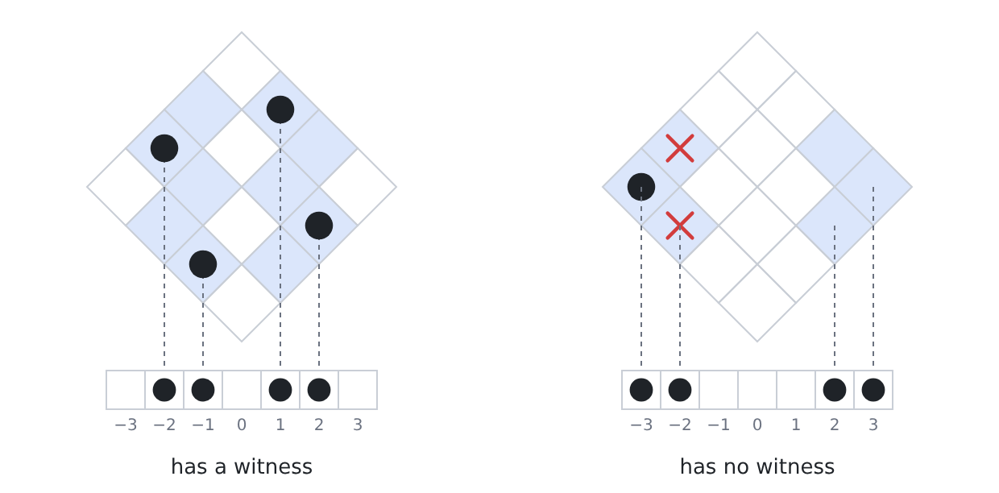

# Binary x-rays of permutations

Research notes, data and code for an open conjecture about permutation matrices. **[Progress dashboard](https://claude.ai/artifact/PnNNnhXRqfmtgrEThzoG9Z)**: what is proved, what holds in tests, and what has been ruled out (other ways to open it are under [Opening the dashboard](#opening-the-dashboard)).

## The question

Given n distinct diagonals of an n×n matrix, when is it possible to place n non-attacking rooks in the matrix with exactly one on each given diagonal? Equivalently: for which 0/1 vectors of length 2n − 1 is there a permutation matrix whose entries, projected onto the anti-diagonal, give exactly that vector? We call such a permutation matrix a *witness* for the vector.

On the left, a permutation matrix and its projection. On the right, a vector with no witness: diagonal −3 is a single cell, and both cells of diagonal −2 share its row or its column.

A 2005 paper by Bebeacua, Mansour, Postnikov and Severini proposes a condition on the vector, which is most intuitively described by the following process.

**Figure 1.** Place n points on alternating indices: −6, −4, …, 4, 6 (here n = 7). This is the *starting vector*. Notice that it is also the projection of the matrix with points along the anti-diagonal.

**Figure 2.** A *move* takes any two points and moves each one index closer to the other, keeping all points on distinct indices. Here the points at −6 and 0 move to −5 and −1.

**Figure 3.** A second move: the points at 2 and 6 move to 3 and 5.

**Figure 4.** It turns out that after enough moves, you always reach the same final vector, where no move is legal:
- n odd: the points fill the n middle indices.
- n even: the points fill the n + 1 middle indices, excluding the center.

**Figure 5.** A vector is *reachable* if some sequence of legal moves takes the starting vector to it. The top vector is reachable by the two moves above. The bottom one is not: a move never decreases the sum of the k leftmost points, and here the two leftmost sum to −11, below the starting −10.

One can easily show that if a vector is the projection of some permutation matrix, then it is reachable. But is every reachable vector also the projection of some permutation matrix? In other words, if I give you any reachable vector as the prescribed diagonals of an n×n matrix, can you always slide the points along their prescribed diagonals until they occupy distinct rows and columns?

That is the conjecture (Bebeacua–Mansour–Postnikov–Severini 2005, Conjecture 5; Nordh 2008, Conjecture 10). It has been checked by computer for every n ≤ 22.

## What's here

| Path | For | What it is |
|---|---|---|
| `map/graph.json` | agents | **The claims graph.** Every node is one precise claim with a status (proved / empirical / open / disproved / idea). Edges are logical implications; an array `from` is an ∧-junction. This is the canonical machine-readable map of what is known, what was tried, and how it fits together. |
| `map/index.html` | humans | **The dashboard.** Overview (leads, results, dead ends, latest changes), Families (which kinds of arrangement are proved, with an atlas and a lookup), Routes (every card grouped by method), Cards (search), Graph (what implies what). Open the file in a browser; no server is needed. On a phone: see "Opening the dashboard" below. |
| `map/graph.html` | humans | The logic graph on its own page. The dashboard shows it under Graph. |
| `map/build.py` | both | **Source of truth for the graph.** Edit here, then run `python3 map/build.py`; it writes `graph.json`, `graph.js` (the same data for the pages) and `card_dates.txt`. Proof sketches live in `proofs.json`. |
| `map/dashboard_data.py` | both | Curated text for the dashboard: the routes (each card is in exactly one), the highlights on the front page, the families. |
| `map/bundle.py` | humans | Writes the whole dashboard as one HTML file that can be sent as an attachment. |
| `docs/claims-map-guide.md` | both | **Principles and rules for the graph. Read before adding anything.** |
| `docs/state.md` | agents | Dense research state: every result with its range and script, the open lines, and what's ruled out and why. |
| `docs/research-practices.md` | both | How we run and record experiments. |
| `docs/delegation-queue.md` | agents | Side tasks for outside agents, and how to report. |
| `agents/` | agents | Code and outputs from every experiment, one folder per investigation (see `agents/SETUP.md` for the shared definitions). |

## Opening the dashboard

- **On this machine:** open `map/index.html` in a browser. Nothing needs to be served.
- **As one file:** `python3 map/bundle.py` writes `map/dashboard-single.html` with the data, the labs and the graph inside. Send it as an attachment and open it in a browser.
- **As a link:** a snapshot of the dashboard is published at https://claude.ai/artifact/PnNNnhXRqfmtgrEThzoG9Z. It is rebuilt by hand, so it can lag behind `main`.
- **On GitHub Pages:** the repository is ready for Pages; it is not switched on. The steps, and what becomes public, are in `docs/claims-map-guide.md` §7. The address would be https://andrew-spears.github.io/binary-xray-permutations/.

## For contributors and agents

### The principles in one screen

The full version is in `docs/claims-map-guide.md`.

1. **Every node is one precise logical statement**, such as "for every …, there exists …" or "if …, then …". It is never a topic, a description or a construction. Constructions are stated as if–then lemmas.
2. **Status refers to exactly that statement.** "Ruled out" means a counterexample to that exact statement is known; it never means "we searched and found nothing".
3. **Don't refute something too strong and move on.** If a search for a rule fails, the parent claim (a weaker existence statement) stays open, and the specific failed rules hang under it as red children. We never write "a simple rule exists" nodes. "Some procedure works" is trivially true if the conjecture is, and "simple" isn't defined.
4. **Induction routes follow one template.** An invariant P comes with three claims:
   - start: the initial state has P;
   - step: every unfinished state with P has *some* next step keeping P;
   - exact at the end: a finished state with P is a solution.

   Start and step are separate nodes joined by ∧; specific step choices are children of the step node. Every invariant says why it isn't the conjecture in disguise.
5. **Cards are for humans.** Exposition first: define the notion, give an example picture specific to this claim, then say the claim in plain words. Numbers go in `evidence`, proofs in `proof`. A card describes only its own claim.
6. **Explicit case splits.** Use named sets joined by ∧ (e.g. symmetric vs non-symmetric; odd vs even n). Never use "settles part of" edges.

### Working conventions

- **Standing reductions:** only D with no tight cut matter (tight cuts split), and D and −D are equivalent (transpose the board).
- **Recording experiments:** every experiment gets a folder in `agents/` and a line in `docs/state.md`. The line gives the exact question, the range, whether the check was exhaustive, the smallest counterexample, and the script name.
- **Reporting:** return HIT (a precise claim with its range and a recheck command) or NOTHING (see `docs/delegation-queue.md`). A rule that is right 90% of the time is not a hit.
- **Updating the graph:** add or change nodes in `map/build.py`, put each new card's id in one route in `map/dashboard_data.py`, run `python3 map/build.py`, check that the pictures are valid witnesses, and keep the statement, status and evidence consistent with `docs/state.md`.
