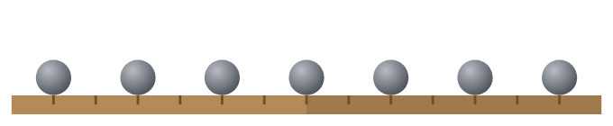
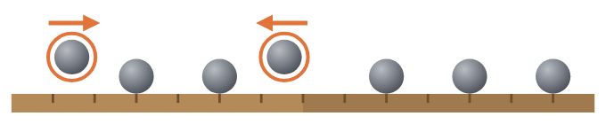
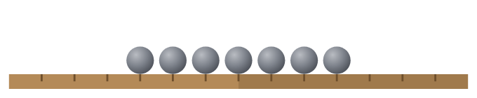
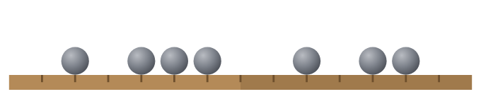
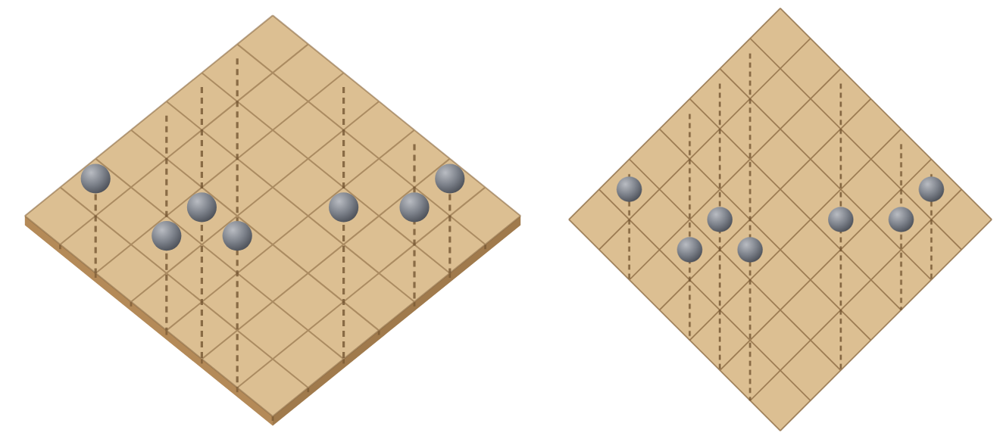
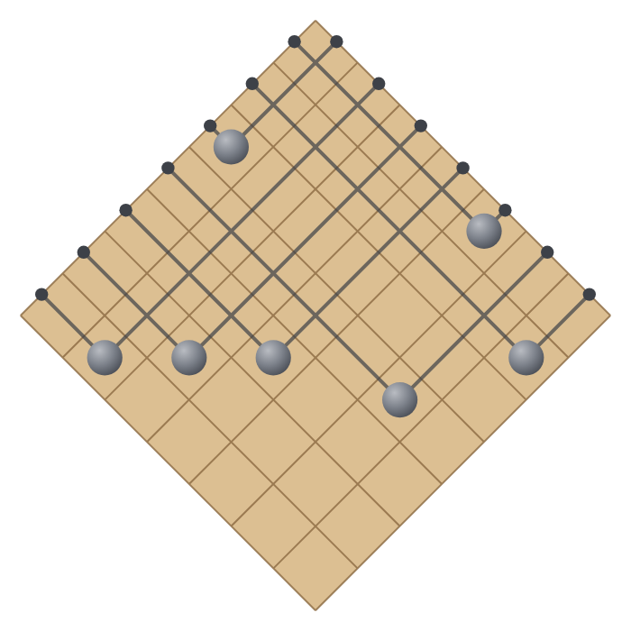

# Binary x-rays of permutations

Research notes, data and code for an open conjecture about permutations: **Bebeacua–Mansour–Postnikov–Severini Conjecture 5**, which is the same as **Nordh Conjecture 10**.

**[Open the progress dashboard →](https://claude.ai/artifact/PnNNnhXRqfmtgrEThzoG9Z)** It shows what is proved, what holds in tests, what has been ruled out, and how it all fits together.

## The puzzle, in pictures

There's an interactive version of this walkthrough in the [equivalent views lab](https://claude.ai/artifact/QLBTrw2VAiCUpzDjjQsegN).

Take a plank with 2n − 1 marks, labelled −(n−1), …, n−1. The pictures use n = 7, so the marks run from −6 to 6.

**Figure 1.** Place n stones on every other mark: −6, −4, …, 4, 6. This is the *starting arrangement*.

**Figure 2.** A *move* takes any two stones and slides each one mark toward the other. The stones need not be neighbours. A move is legal when the two marks the stones land on are empty and different from each other. Here the stones at −6 and 0 move to −5 and −1.

**Figure 3.** A second move: the stones at 2 and 6 move to 3 and 5.

**Figure 4.** Every move brings two stones closer together, so you can't keep moving forever. Eventually you reach an arrangement where no move is legal. Whatever moves you choose, it's always the same final arrangement. For n odd, the stones fill the n middle marks, as in Figure 4. For n even, they fill the n + 1 middle marks except the centre mark 0.

**Figure 5.** An arrangement is *reachable* if some sequence of legal moves takes the starting arrangement to it. This one is reachable: it is the result of the moves in Figures 2 and 3, followed by the stones at −4 and 3 moving to −3 and 2.

**Figure 6.** So far a stone's position has been a single number. Now give the plank a second dimension. The stones actually sit on an n×n board, and each mark on the plank stands for one diagonal of that board: the cells with a fixed value of column − row. The dashed lines in Figure 6 run along the diagonals that hold a stone. Seen edge-on from the front, each diagonal shrinks to a single point, which is a tick on the plank, so the 13 marks are the 13 diagonals of a 7×7 board. The plank picture records only *which diagonals* hold a stone. Within its diagonal, a stone may sit in any cell, and from the side every such placement looks the same.

**Figure 7.** Everything up to now was a construction: a way to produce sets of diagonals. This is the actual puzzle. Take a reachable arrangement, then slide each stone along its own diagonal so that every row and every column of the board contains exactly one stone; in other words, the stones form a permutation matrix. In Figure 7, each stone sends one line along its row and one along its column to the board's two upper edges, and every row and every column is hit exactly once. Finding such a placement is the hard part. Moving one stone to free up a row usually takes its new row or column from another stone, and no general method is known.

**The conjecture:** for every n, every reachable arrangement of n stones on the plank can be placed on the n×n board, each stone on its own diagonal, with every row and every column containing exactly one stone.

## The conjecture, formally

Number the cells of the n×n board by (row i, column j) and call d = j − i the cell's **diagonal**, so −(n−1) ≤ d ≤ n−1. A permutation π uses the diagonals π(i) − i, one per row. Given a set D of n distinct diagonals, a **witness** for D is a permutation that uses every diagonal in D exactly once. Equivalently, D is the *binary diagonal x-ray* of π: every diagonal holds one point of π or none.

Write D = {d₁ < d₂ < … < dₙ} and s_k = d_k + n − k. **Landau's condition** says s is the score sequence of a tournament:

  s₁ + … + s_k ≥ k(k−1)/2 for every k, with equality at k = n.

> **Conjecture** (Bebeacua–Mansour–Postnikov–Severini 2005, Conj. 5; Nordh 2008, Conj. 10). D has a witness **if and only if** D satisfies Landau's condition.

How this matches the pictures: the stones sit at the marks d ∈ D. Balance is the equality at k = n, since it says Σ d = 0. The starting position, a stone on every other mark, is D = {−(n−1), −(n−3), …, n−1}. The arrangements reachable from it by moves are exactly the ones satisfying Landau's condition (proved; card `mm` in the graph). Each move lowers Σ d², so moves terminate. When no move is legal, the stones form one block of consecutive marks, or two blocks with a single empty mark between them, and Σ d = 0 then forces the final arrangement of Figure 4.

**Status.** The "only if" direction is known. The "if" direction is open; it has been checked by exhaustive search for every n ≤ 22. If D has a *tight cut* (equality for some k < n), it splits into two smaller instances, so only the D with no tight cut matter. Nordh's formulation is about extremal Skolem sets: put rows at positions 1…n and columns at n+1…2n, and a witness becomes a pairing of {1, …, 2n} whose pair lengths are n + D.

## What's here

| Path | For | What it is |
|---|---|---|
| `map/graph.json` | agents | **The claims graph.** Every node is one precise claim with a status (proved / empirical / open / disproved / idea). Edges are logical implications; an array `from` is an ∧-junction. This is the canonical machine-readable map of what is known, what was tried, and how it fits together. |
| `map/index.html` | humans | **The dashboard.** Overview (leads, results, dead ends, latest changes), Families (which kinds of arrangement are proved, with an atlas and a lookup), Routes (every card grouped by method), Cards (search), Graph (what implies what). Open the file in a browser; no server is needed. On a phone: see "Opening the dashboard" below. |
| `map/graph.html` | humans | The logic graph on its own page. The dashboard shows it under Graph. |
| `map/build.py` | both | **Source of truth for the graph.** Edit here, then run `python3 map/build.py`; it writes `graph.json`, `graph.js` (the same data for the pages) and `card_dates.txt`. Proof sketches live in `proofs.json`. |
| `map/dashboard_data.py` | both | Curated text for the dashboard: the routes (each card is in exactly one), the highlights on the front page, the families. |
| `map/bundle.py` | humans | Writes the whole dashboard as one HTML file that can be sent as an attachment. |
| `docs/claims-map-guide.md` | both | **Principles and rules for the graph. Read before adding anything.** |
| `docs/state.md` | agents | Dense research state: every result with its range and script, the open lines, and what's ruled out and why. |
| `docs/research-practices.md` | both | How we run and record experiments. |
| `docs/delegation-queue.md` | agents | Side tasks for outside agents, and how to report. |
| `agents/` | agents | Code and outputs from every experiment, one folder per investigation (see `agents/SETUP.md` for the shared definitions). |

## The principles in one screen

The full version is in `docs/claims-map-guide.md`.

1. **Every node is one precise logical statement**, such as "for every …, there exists …" or "if …, then …". It is never a topic, a description or a construction. Constructions are stated as if–then lemmas.
2. **Status refers to exactly that statement.** "Ruled out" means a counterexample to that exact statement is known; it never means "we searched and found nothing".
3. **Don't refute something too strong and move on.** If a search for a rule fails, the parent claim (a weaker existence statement) stays open, and the specific failed rules hang under it as red children. We never write "a simple rule exists" nodes. "Some procedure works" is trivially true if the conjecture is, and "simple" isn't defined.
4. **Induction routes follow one template.** An invariant P comes with three claims:
   - start: the initial state has P;
   - step: every unfinished state with P has *some* next step keeping P;
   - exact at the end: a finished state with P is a solution.

   Start and step are separate nodes joined by ∧; specific step choices are children of the step node. Every invariant says why it isn't the conjecture in disguise.
5. **Cards are for humans.** Exposition first: define the notion, give an example picture specific to this claim, then say the claim in plain words. Numbers go in `evidence`, proofs in `proof`. A card describes only its own claim.
6. **Explicit case splits.** Use named sets joined by ∧ (e.g. symmetric vs non-symmetric; odd vs even n). Never use "settles part of" edges.

## Working conventions

- **Standing reductions:** only D with no tight cut matter (tight cuts split), and D ~ −D (mirror).
- **Recording experiments:** every experiment gets a folder in `agents/` and a line in `docs/state.md`. The line gives the exact question, the range, whether the check was exhaustive, the smallest counterexample, and the script name.
- **Reporting:** return HIT or NOTHING (see `docs/delegation-queue.md`). A rule that is right 90% of the time is not a hit.
- **Updating the graph:** add or change nodes in `map/build.py`, put each new card's id in one route in `map/dashboard_data.py`, run `python3 map/build.py`, check that the pictures are valid witnesses, and keep the statement, status and evidence consistent with `docs/state.md`.

## Opening the dashboard

- **On this machine:** open `map/index.html` in a browser. Nothing needs to be served.
- **As one file:** `python3 map/bundle.py` writes `map/dashboard-single.html` with the data, the labs and the graph inside. Send it as an attachment and open it in a browser.
- **As a link:** a snapshot of the dashboard is published at https://claude.ai/artifact/PnNNnhXRqfmtgrEThzoG9Z. It is rebuilt by hand, so it can lag behind `main`.
- **On GitHub Pages:** the repository is ready for Pages; it is not switched on. The steps, and what becomes public, are in `docs/claims-map-guide.md` §7. The address would be https://andrew-spears.github.io/binary-xray-permutations/.
