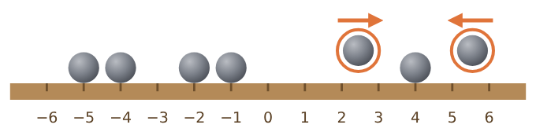
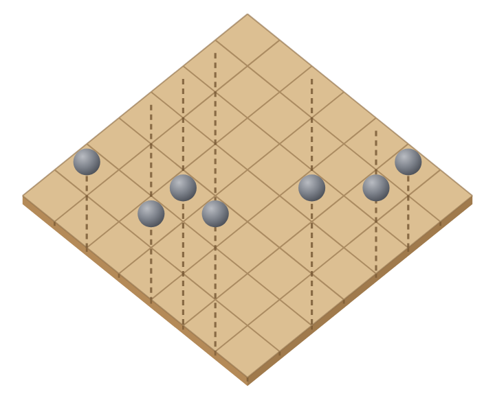
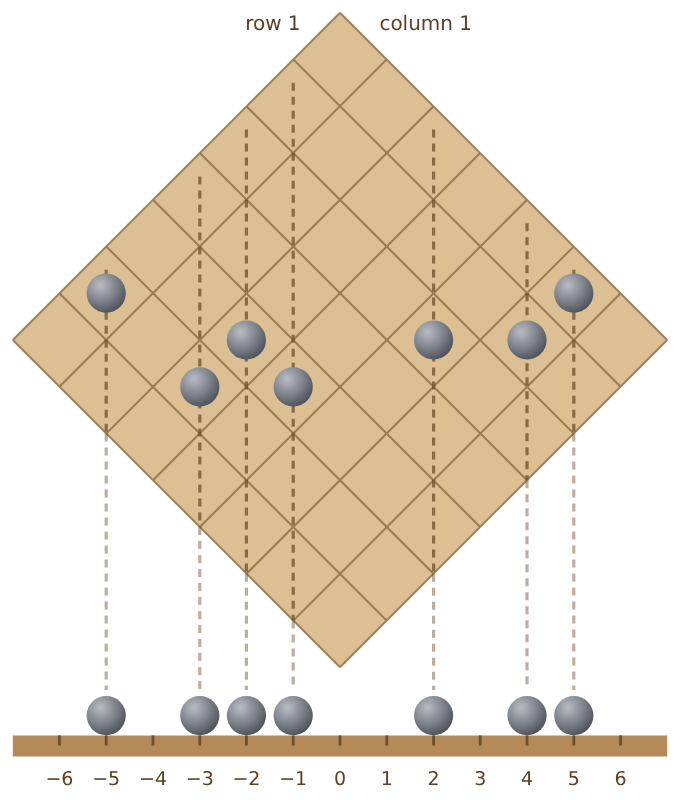

# Binary x-rays of permutations

**The question:** given n distinct diagonals of an n×n board, when can you place n non-attacking rooks so that each of those diagonals holds exactly one rook? A 2005 conjecture gives a simple answer. This repository holds research notes, data and code for proving or disproving it. The conjecture is **Bebeacua–Mansour–Postnikov–Severini Conjecture 5**, which is the same as **Nordh Conjecture 10**.

**[Progress dashboard](https://claude.ai/artifact/PnNNnhXRqfmtgrEThzoG9Z):** what is proved, what holds in tests, what has been ruled out, and how it fits together. It is a claude.ai page; if it doesn't open for you, clone the repository and open `map/index.html` in a browser.

## The puzzle, in pictures

Take a plank with 2n − 1 marks, labelled −(n−1), …, n−1. The pictures use n = 7, so the marks run from −6 to 6.

**Figure 1.** Place n stones on every other mark: −6, −4, …, 4, 6. This is the *starting arrangement*.

<p align="center"></p>

**Figure 2.** A *move* takes two stones at marks a < b, where b − a ≥ 3 and the marks a + 1 and b − 1 are both empty, and moves them to a + 1 and b − 1. In words: each stone slides one mark toward the other. The two stones need not be neighbours. One stone moves right by one and the other left by one, so the sum of the stones' positions never changes; it stays 0. Here the stones at −6 and 0 move to −5 and −1.

<p align="center"></p>

**Figure 3.** A second move: the stones at 2 and 6 move to 3 and 5.

<p align="center"></p>

**Figure 4.** A move from a, b to a + 1, b − 1 lowers the sum of the squared positions by 2(b − a − 1) > 0, so no sequence of moves goes on forever. Eventually you reach an arrangement where no move is legal. Whatever moves you choose, it is always the same final arrangement:
- **n odd:** the stones fill the n middle marks, as shown here.
- **n even:** the stones fill the n + 1 middle marks except the centre mark 0.

<p align="center"></p>

**Figure 5.** An arrangement is *reachable* if some sequence of legal moves takes the starting arrangement to it. This one is reachable: it is the result of the moves in Figures 2 and 3, followed by the stones at −4 and 3 moving to −3 and 2. Not every arrangement whose positions sum to 0 is reachable; there is an example below.

<p align="center"></p>

**Figure 6.** Now read the plank as the side view of a board. Take an n×n board turned 45°, so that one corner points up. Number its rows 1, …, n down the upper-left edge and its columns 1, …, n down the upper-right edge. The cell in row i, column j lies on the *diagonal* j − i. In this picture the cells of one diagonal form a vertical line, from −(n−1) on the far left to n−1 on the far right.

Seen edge-on from the front, each of these vertical lines collapses to a single point. The 2n − 1 diagonals become exactly the 2n − 1 marks of the plank. Figure 6a shows the board tilted. Figure 6b shows it from above, with the plank of Figure 5 underneath: the dashed lines run down the diagonals that hold a stone, onto those stones' marks.

So a plank arrangement records only *which diagonals* hold a stone. Within its diagonal, a stone may sit in any cell, and from the side every such placement looks the same. In Figure 6 the stones are placed arbitrarily, and several of them share a row or a column.

<p align="center"></p>

<p align="center"></p>

**Figure 7.** Everything up to now was a construction: a way to produce sets of diagonals. This is the actual puzzle. Take a reachable arrangement, then slide each stone along its own diagonal so that every row and every column of the board contains exactly one stone. In other words, the stones form a permutation matrix.

In Figure 7, each stone sends one line along its row to the upper-left edge and one along its column to the upper-right edge, and every row and every column is hit exactly once. Reading the rows in order, rows 1, …, 7 hold stones in columns 5, 7, 1, 6, 4, 3, 2. That is the permutation π = 5716432. Its diagonals π(i) − i are 4, 5, −2, 2, −1, −3, −5, the marks of Figure 5.

Finding such a placement is the hard part. Moving one stone to free up a row usually takes its new row or column from another stone, and no general method is known.

<p align="center"></p>

**The conjecture:** for every n, every reachable arrangement of n stones on the plank can be placed on the n×n board, each stone in some cell of the diagonal given by its mark, with every row and every column containing exactly one stone.

The converse is known: an arrangement that is not reachable can never be placed. So the conjecture says that an arrangement can be placed *exactly when* it is reachable.

For example, take n = 4 and the arrangement {−3, −2, 2, 3}. Its positions sum to 0, but it is not reachable, and it cannot be placed. Diagonal −3 is the single cell in row 4, column 1. The two cells of diagonal −2 are (row 3, column 1) and (row 4, column 2), and each shares a column or a row with it.

**A small case.** For n = 3 the reachable arrangements are {−2, 0, 2} (the start) and {−1, 0, 1} (the final arrangement). Here are placements for both, drawn as ordinary matrices with row 1 on top. The board pictures above are these matrices turned 45°.

```
{−2, 0, 2}       {−1, 0, 1}
 . . ●            ● . .
 . ● .            . . ●
 ● . .            . ● .
```

An interactive version of this walkthrough is in the [equivalent views lab](https://claude.ai/artifact/QLBTrw2VAiCUpzDjjQsegN) (a claude.ai page).

## The conjecture, formally

Number the cells of the n×n board by (row i, column j), and call d = j − i the cell's **diagonal**, so −(n−1) ≤ d ≤ n−1. A permutation π puts one point in each row i, at column π(i). Its **diagonal x-ray** is the vector counting π's points on each of the 2n − 1 diagonals. The x-ray is **binary** when every count is 0 or 1. Then the diagonals used form a set D of exactly n diagonals, and π is a **witness** for D. The plank picture is this x-ray: it is the board seen edge-on, which is where the name comes from.

Write D = {d₁ < d₂ < … < dₙ}. **Landau's condition** on D is:

  d₁ + … + d_k ≥ −k(n − k) for every k, with equality at k = n (that is, Σ d = 0).

It is necessary. Any k points of a permutation lie in k distinct rows and k distinct columns, so their diagonals sum to at least (1 + … + k) − ((n−k+1) + … + n) = −k(n − k). Apply this to the points on the k lowest diagonals. The name: with s_k = d_k + n − k, the condition says exactly that s is the score sequence of a tournament on n players, by Landau's theorem (1953).

> **Conjecture** (Bebeacua–Mansour–Postnikov–Severini 2005, Conj. 5; Nordh 2008, Conj. 10). D has a witness **if and only if** D satisfies Landau's condition.

**How this matches the pictures.**
- The stones sit at the marks d ∈ D, and a move keeps Σ d = 0.
- The starting arrangement is D = {−(n−1), −(n−3), …, n−1}.
- The arrangements reachable from it are exactly the ones satisfying Landau's condition (proved; see the dashboard).
- Why the final arrangement is unique: when no move is legal, the stones form one block of consecutive marks, or two blocks with a single empty mark between them. Σ d = 0 then leaves only the arrangement described in Figure 4.

**Status.** The "only if" direction is the necessity argument above. The "if" direction is open; it has been checked by exhaustive search for every n ≤ 22.

**Tight cuts.** Suppose equality holds at some k < n. Then the bound in the necessity argument is attained, so the k points on the k lowest diagonals fill rows n−k+1, …, n and columns 1, …, k: the k×k block in the lower-left corner. The other n − k diagonals then form an independent instance of size n − k in the upper-right block. So only the D with no tight cut matter.

**Skolem form.** Nordh's formulation is about extremal Skolem sets. Put rows at positions 1, …, n and columns at n+1, …, 2n, and a witness becomes a pairing of {1, …, 2n} whose pair lengths are n + D. These lengths sum to n², the largest total any pairing of {1, …, 2n} can have, and a pairing reaches it only when every pair joins one of 1, …, n to one of n+1, …, 2n. So such pairings correspond exactly to witnesses.

## What's here

| Path | For | What it is |
|---|---|---|
| `map/graph.json` | agents | **The claims graph.** Every node is one precise claim with a status (proved / empirical / open / disproved / idea). Edges are logical implications; an array `from` is an ∧-junction. This is the canonical machine-readable map of what is known, what was tried, and how it fits together. |
| `map/index.html` | humans | **The dashboard.** Overview (leads, results, dead ends, latest changes), Families (which kinds of arrangement are proved, with an atlas and a lookup), Routes (every card grouped by method), Cards (search), Graph (what implies what). Open the file in a browser; no server is needed. On a phone: see "Opening the dashboard" below. |
| `map/graph.html` | humans | The logic graph on its own page. The dashboard shows it under Graph. |
| `map/build.py` | both | **Source of truth for the graph.** Edit here, then run `python3 map/build.py`; it writes `graph.json`, `graph.js` (the same data for the pages) and `card_dates.txt`. Proof sketches live in `proofs.json`. |
| `map/dashboard_data.py` | both | Curated text for the dashboard: the routes (each card is in exactly one), the highlights on the front page, the families. |
| `map/bundle.py` | humans | Writes the whole dashboard as one HTML file that can be sent as an attachment. |
| `docs/claims-map-guide.md` | both | **Principles and rules for the graph. Read before adding anything.** |
| `docs/state.md` | agents | Dense research state: every result with its range and script, the open lines, and what's ruled out and why. |
| `docs/research-practices.md` | both | How we run and record experiments. |
| `docs/delegation-queue.md` | agents | Side tasks for outside agents, and how to report. |
| `agents/` | agents | Code and outputs from every experiment, one folder per investigation (see `agents/SETUP.md` for the shared definitions). |

## Opening the dashboard

- **On this machine:** open `map/index.html` in a browser. Nothing needs to be served.
- **As one file:** `python3 map/bundle.py` writes `map/dashboard-single.html` with the data, the labs and the graph inside. Send it as an attachment and open it in a browser.
- **As a link:** a snapshot of the dashboard is published at https://claude.ai/artifact/PnNNnhXRqfmtgrEThzoG9Z. It is rebuilt by hand, so it can lag behind `main`.
- **On GitHub Pages:** the repository is ready for Pages; it is not switched on. The steps, and what becomes public, are in `docs/claims-map-guide.md` §7. The address would be https://andrew-spears.github.io/binary-xray-permutations/.

## For contributors and agents

### The principles in one screen

The full version is in `docs/claims-map-guide.md`.

1. **Every node is one precise logical statement**, such as "for every …, there exists …" or "if …, then …". It is never a topic, a description or a construction. Constructions are stated as if–then lemmas.
2. **Status refers to exactly that statement.** "Ruled out" means a counterexample to that exact statement is known; it never means "we searched and found nothing".
3. **Don't refute something too strong and move on.** If a search for a rule fails, the parent claim (a weaker existence statement) stays open, and the specific failed rules hang under it as red children. We never write "a simple rule exists" nodes. "Some procedure works" is trivially true if the conjecture is, and "simple" isn't defined.
4. **Induction routes follow one template.** An invariant P comes with three claims:
   - start: the initial state has P;
   - step: every unfinished state with P has *some* next step keeping P;
   - exact at the end: a finished state with P is a solution.

   Start and step are separate nodes joined by ∧; specific step choices are children of the step node. Every invariant says why it isn't the conjecture in disguise.
5. **Cards are for humans.** Exposition first: define the notion, give an example picture specific to this claim, then say the claim in plain words. Numbers go in `evidence`, proofs in `proof`. A card describes only its own claim.
6. **Explicit case splits.** Use named sets joined by ∧ (e.g. symmetric vs non-symmetric; odd vs even n). Never use "settles part of" edges.

### Working conventions

- **Standing reductions:** only D with no tight cut matter (tight cuts split), and D and −D are equivalent (transpose the board).
- **Recording experiments:** every experiment gets a folder in `agents/` and a line in `docs/state.md`. The line gives the exact question, the range, whether the check was exhaustive, the smallest counterexample, and the script name.
- **Reporting:** return HIT (a precise claim with its range and a recheck command) or NOTHING (see `docs/delegation-queue.md`). A rule that is right 90% of the time is not a hit.
- **Updating the graph:** add or change nodes in `map/build.py`, put each new card's id in one route in `map/dashboard_data.py`, run `python3 map/build.py`, check that the pictures are valid witnesses, and keep the statement, status and evidence consistent with `docs/state.md`.
